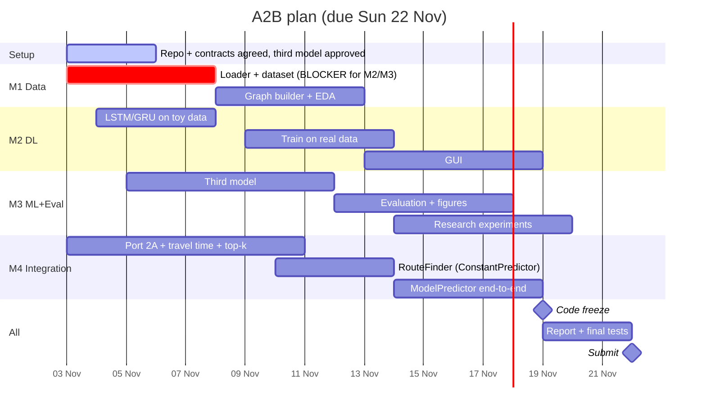
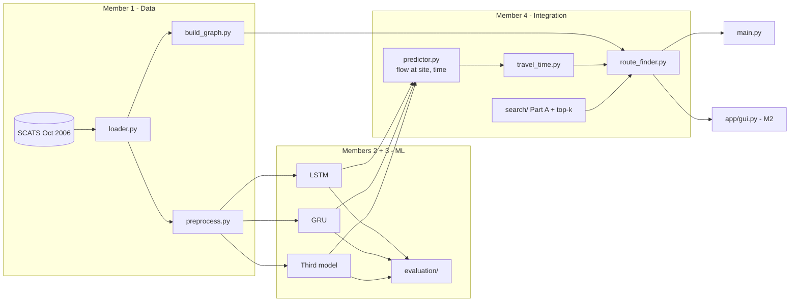

# TBRGS - Traffic-Based Route Guidance System

**COS30019 Introduction to AI - Assignment 2B (Machine Learning & Software Integration)**
Due **Sunday 22 Nov 2026, 23:59** (Week 11) - group of 4 - 50% of Assignment 2

The system predicts traffic flow at Boroondara intersections (SCATS sites) with ML models (LSTM, GRU and a third model),
converts the predicted flow into travel time, and uses our Assignment 2A search algorithms to return **up to 5 routes**
from an origin to a destination SCATS site, through a CLI and a GUI.

---

## Team & task split

> Fill in names/IDs. Each member owns their files end-to-end: code, tests, the matching report section, and the
> explanation to the tutor in class.

| | Member | Student ID | Role | Owns (files) | Rubric marks owned |
|---|---|---|---|---|---|
| **M1** | _name_ | _id_ | **Data & Graph + Test lead** | `src/data/*`, `src/graph/build_graph.py`, `notebooks/01_eda`, `tests/test_data.py`, `tests/test_graph.py`, `docs/TEST_CASES.md` | Data processing **9** + Testing **10** (lead) |
| **M2** | _name_ | _id_ | **Deep Learning + GUI** | `src/models/lstm.py`, `src/models/gru.py`, `src/training/train.py`, `app/gui.py` | ML algorithms **14** (LSTM + GRU) |
| **M3** | _name_ | _id_ | **Third model + Evaluation + Research** | `src/models/third_model.py`, `src/evaluation/*`, `results/` | ML algorithm **7** + Evaluation **15** + Research **15** (lead) |
| **M4** | _name_ | _id_ | **Integration (Part A port + routing)** | `src/search/*`, `src/routing/*`, `src/prediction/predictor.py`, `main.py` | Integration **15** |
| All | | | Report sections (see `docs/REPORT_PLAN.md`) | `report/` | Report **15** |

### Member 1 - Data & Graph + Test lead
- [ ] `load_raw`, `to_long`, `fix_coordinates`, `load_long` (read `docs/DATA_NOTES.md` first - 5 quirks to handle)
- [ ] `make_windows`, `chronological_split`, `build_dataset`, `latest_window`
- [ ] **Priority:** push a working `load_long()` + `build_dataset()` by **Sun 8 Nov** - M2 and M3 depend on it
- [ ] `parse_location` + `build_graph` (infer road links between the 40 sites, check against `docs/Boroondara_SCATS_map.pdf`)
- [ ] EDA notebook: daily profile per site, weekday vs weekend, missing data -> figures for the report
- [ ] Test lead: keep `docs/TEST_CASES.md` filled in, collect results for the report
- [ ] Report: cover page + contribution statement, Introduction, Data processing, Testing (test cases)

### Member 2 - Deep Learning + GUI
- [ ] Study https://github.com/hyswin/Example-LSTM-and-GRU-for-A2B-COS30019-
- [ ] `LSTMModel` and `GRUModel` following `BaseTrafficModel` (share one training helper so the comparison is fair)
- [ ] `train_model` / `train_all`: save models, scaler, loss history
- [ ] Until M1's data is ready, develop with the random `toy_xy` data from `tests/conftest.py`
- [ ] `app/gui.py` (Streamlit): inputs, settings, route table, map, model-comparison tab
- [ ] Report: LSTM/GRU section, Conclusion, GUI screenshots for Instructions

### Member 3 - Third model + Evaluation + Research
- [ ] Choose the third model and **get tutor approval in class** (ideas in `src/models/third_model.py`)
- [ ] `ThirdModel` following `BaseTrafficModel`
- [ ] `metrics.py` (MAE, RMSE, NRMSE, MAPE, R2) + `compare.py` (tables + figures in `results/`)
- [ ] Comprehensive comparison: per site, per hour, peak vs off-peak, weekday vs weekend, training time, effect of `lags`
- [ ] Lead the Research initiative (pick with the team, see ideas below)
- [ ] Report: third model, Insights, Research, Testing (model evaluation part)

### Member 4 - Integration
- [ ] Port our 2A algorithms (BFS, DFS, GBFS, A*, CUS1, CUS2) into `src/search/algorithms.py` with the new `cost_fn`
- [ ] `k_shortest_paths` (Yen's algorithm) -> up to 5 loopless routes
- [ ] `flow_to_speed` + `edge_travel_time` (from `docs/Traffic_Flow_to_Travel_Time_Conversion_v1.0.pdf`)
- [ ] `RouteFinder.find_routes` - build and test it **now** with `ConstantPredictor`, no need to wait for models
- [ ] `ModelPredictor` - plug in the trained models once M2/M3 are done
- [ ] `main.py route` works end-to-end; help M2 wire the GUI
- [ ] Report: Instructions, Integration, Features/Bugs/Missing

### Everyone
- Write tests for your own module and make them PASS (25 cases already scaffolded in `tests/`, rubric needs >= 15)
- Give a **progress update to the tutor in every class** (up to -60 individually if you don't)
- Add every resource you use to the report's Acknowledgements with a one-line "how it helped"

---

## Timeline



| Date | Checkpoint |
|---|---|
| Thu 5 Nov | Everyone has run `pytest`, third model + research idea proposed to tutor |
| **Sun 8 Nov** | `load_long()` + `build_dataset()` merged (M1). LSTM/GRU run on toy data (M2) |
| Sun 15 Nov | All 3 models trained & saved. `main.py route` works with ConstantPredictor. Graph done |
| **Thu 19 Nov** | **Code freeze**: end-to-end with real models, GUI working, `results/` figures final |
| Sat 21 Nov | Report draft complete, everyone proofreads, everyone signs the cover page |
| Sun 22 Nov | `scripts/make_submission.sh <TEAM_ID>` -> upload zip |

---

## Architecture



Full contracts (column names, shapes, function signatures): **[`docs/INTERFACES.md`](docs/INTERFACES.md)**.

## Repository layout

```
tbrgs/
├── main.py                    CLI entry point (train / evaluate / route / gui)
├── config.yaml                all defaults (spec requires a config file)
├── app/gui.py                 Streamlit GUI                                   [M2]
├── src/
│   ├── config.py              config loader (done)
│   ├── data/                  loader.py, preprocess.py                        [M1]
│   ├── graph/                 graph.py (shared, done), build_graph.py          [M1]
│   ├── models/                base.py + registry.py (shared, done)
│   │                          lstm.py, gru.py [M2]   third_model.py [M3]
│   ├── training/train.py                                                      [M2]
│   ├── evaluation/            metrics.py, compare.py                          [M3]
│   ├── prediction/predictor.py  FlowPredictor, ConstantPredictor (done), ModelPredictor [M4]
│   ├── search/                algorithms.py (2A port), top_k.py               [M4]
│   └── routing/               travel_time.py, route_finder.py                 [M4]
├── tests/                     25 test cases, unimplemented = XFAIL
├── data/raw/                  Canvas datasets (do not edit)
├── data/processed/            generated cache (git-ignored)
├── models/saved/              trained models (git-ignored)
├── results/                   metrics CSVs + figures for the report (committed)
├── notebooks/                 EDA / experiments (not submitted)
├── reference/                 tutor's example code - study only, NOT submitted
├── docs/                      spec, conversion PDF, map, data notes, interfaces, test plan, report plan
├── report/                    <TEAM_ID>.pdf goes here
└── scripts/make_submission.sh builds the Canvas zip (excludes reference/ and notebooks/)
```

## How to run

```bash
pip install -r requirements.txt

python main.py train --model all          # train LSTM, GRU and the third model
python main.py evaluate                   # comparison table + figures in results/
python main.py route --origin 2000 --dest 3002 --time "2006-10-15 08:00" --model gru
python main.py route --model constant     # routing without ML (debugging)
python main.py gui                        # or: streamlit run app/gui.py

pytest                                    # run the test suite
```

Defaults (paths, lags, epochs, k = 5, 60 km/h, 30 s delay, ...) live in `config.yaml`.

## Key assumptions from the spec

- Speed limit 60 km/h on every link; 30 s average delay per controlled intersection
- Flow -> speed: `flow = -1.4648375*speed^2 + 93.75*speed`, capacity 1500 veh/h at 32 km/h, speed capped at 60 km/h (flow <= ~351 veh/h)
- Edge time = distance / speed + 30 s
- Up to 5 routes per (origin, destination)
- Tutor's example scripts in `reference/` must not be submitted

## Research initiative ideas (pick one, get tutor approval)

1. **Map visualisation** like Google Maps Traffic with OpenStreetMap - colour each edge by predicted congestion (pairs well with the GUI)
2. **Bigger dataset**: VicRoads traffic signal volume data (https://discover.data.vic.gov.au/dataset/traffic-signal-volume-data), multiple years
3. **Extensive experiments**: lags, features (time of day, weekday, neighbour sites), hyper-parameter search, multiple seeds
4. Compare search algorithms on the real network (nodes expanded, runtime) using predicted travel times

## Workflow

See [`CONTRIBUTING.md`](CONTRIBUTING.md): feature branch -> PR into `main` -> 1 review + green CI -> merge -> delete the feature branch.
