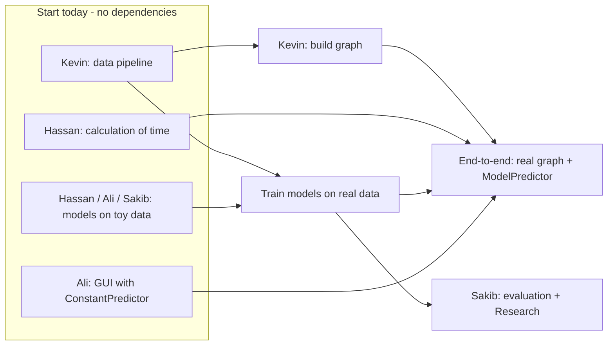
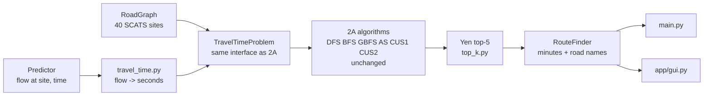

# TBRGS - Traffic-Based Route Guidance System

**COS30019 Introduction to AI - Assignment 2B (Machine Learning & Software Integration)**
Due **Sunday 22 Nov 2026, 23:59** (Week 11) - same team as Assignment 2A - 50% of Assignment 2

The system predicts traffic flow at Boroondara intersections (SCATS sites) with three ML models,
converts the predicted flow into travel time, and reuses **our own Assignment 2A search algorithms**
to return **up to 5 routes** from an origin to a destination SCATS site. The GUI works like a simple
Google Maps: each route shows its **total minutes** and **the roads it takes**.

---

## Team and task split

The split follows the tutor's list (Model 1, Model 2, Model 3, Integration A2A, Calculation of time,
GUI, Research). Data processing is not on the list but everything depends on it, so it goes first.

| Member | Student ID | Tasks | Owns (files) | Rubric marks |
|---|---|---|---|---|
| **Kevin Emmanuel Rusli** | _id_ | Data processing, **Integration A2A**, test lead | `src/data/*`, `src/graph/build_graph.py`, `src/search/adapter.py`, `src/search/top_k.py`, `src/routing/route_finder.py`, `src/prediction/predictor.py`, `main.py` | Data 9, Integration 15, Testing 10 |
| **Hassan Ali Shah Syed** | _id_ | **Model 1 (LSTM)**, **Calculation of time** | `src/models/lstm.py`, `src/training/train.py`, `src/routing/travel_time.py` | ML 7 |
| **Ali Murtaza Shah Syed** | _id_ | **Model 2 (GRU)**, **GUI** | `src/models/gru.py`, `app/gui.py` | ML 7 |
| **Sakib Ahmed** | _id_ | **Model 3** (needs tutor approval), **evaluation**, **Research** | `src/models/third_model.py`, `src/evaluation/*`, `results/` | ML 7, Evaluation 15, Research 15 |
| All | | Report sections (see `docs/REPORT_PLAN.md`) | `report/` | Report 15 |

> Swap names freely if the team agrees, but keep one owner per file.

### Kevin - Data processing + Integration A2A
- [ ] **Today:** `load_raw`, `to_long`, `fix_coordinates`, `load_long`, `make_windows`, `chronological_split`, `build_dataset`, `latest_window` (read `docs/DATA_NOTES.md` first). Push as soon as it works: all three model owners are waiting on it.
- [ ] `parse_location` + `build_graph`: infer road links between the 40 sites, **store the road name on every edge** (the GUI shows it), check against `docs/Boroondara_SCATS_map.pdf`
- [x] `TravelTimeProblem` adapter so our 2A algorithms run unchanged (`src/search/adapter.py`)
- [x] Yen top-5 on top of the 2A search (`src/search/top_k.py`), verified against brute force
- [x] `RouteFinder` returning routes with minutes, km and road names
- [ ] `ModelPredictor` once models are trained; `main.py route` end-to-end
- [ ] Test lead: keep `docs/TEST_CASES.md` filled in
- [ ] Report: cover page + contribution statement, Introduction, Data processing, Integration, Features/Bugs/Missing, Testing (cases)

### Hassan - Model 1 (LSTM) + Calculation of time
- [ ] Study https://github.com/hyswin/Example-LSTM-and-GRU-for-A2B-COS30019-
- [ ] `LSTMModel` following `BaseTrafficModel`; write `train.py` as a shared loop that Ali (GRU) and Sakib reuse
- [ ] Until Kevin's data lands, develop on the random `toy_xy` data in `tests/conftest.py`
- [ ] `flow_to_speed` + `edge_travel_time` from `docs/Traffic_Flow_to_Travel_Time_Conversion_v1.0.pdf` (tests TC14-TC16 already describe the expected numbers). **No data needed, can be done today**
- [ ] Report: LSTM section, travel-time conversion section

### Ali Murtaza - Model 2 (GRU) + GUI
- [ ] `GRUModel` following `BaseTrafficModel`, same training loop as LSTM so the comparison is fair
- [ ] `app/gui.py`: simple Google-Maps-style page, see **`docs/GUI_SPEC.md`**. Build it with `ConstantPredictor` first, no need to wait for the models
- [ ] Report: GRU section, Instructions (with GUI screenshots), Conclusion

### Sakib - Model 3 + evaluation + Research
- [ ] Choose Model 3 and **get tutor approval in class** (ideas in `src/models/third_model.py`)
- [ ] `ThirdModel` following `BaseTrafficModel`
- [ ] `metrics.py` (MAE, RMSE, NRMSE, MAPE, R2) + `compare.py` (tables + figures in `results/`)
- [ ] Research: pick one initiative with the team (ideas below), get it approved, run the experiments
- [ ] Report: Model 3, Insights (which model is better and why, with data), Research

### Everyone
- Tests for your own module must PASS (28 numbered test cases already scaffolded; the rubric needs >= 15)
- Give a **progress update to the tutor in every class** (up to -60 individually if you don't)
- Log AI use in `docs/ai-usage-log.md` after every session (same rule as 2A)
- Add every resource you use to the report's Acknowledgements with a one-line "how it helped"

---

## Order of work



| Date | Checkpoint |
|---|---|
| **Tue 3 Nov** | Kevin's data pipeline pushed. Hassan's travel-time functions pass TC14-TC16 |
| Thu 5 Nov | Model 3 + Research idea approved by the tutor. LSTM/GRU/Model 3 run on toy data |
| Sun 8 Nov | Graph built (2000 -> 3002 reachable). Models training on real data |
| Sun 15 Nov | All 3 models trained and saved. GUI shows routes with ConstantPredictor |
| **Thu 19 Nov** | **Code freeze**: end-to-end with real models, GUI final, `results/` figures final |
| Sat 21 Nov | Report draft complete, everyone proofreads and signs the cover page |
| Sun 22 Nov | `scripts/make_submission.sh <TEAM_ID>` -> upload zip |

---

## How Part A is integrated

Our 2A algorithms are copied **unchanged** into `src/search/a2a/algorithms/`. They only talk to a
`problem` object, so `TravelTimeProblem` gives them the same interface as 2A's `problem.py`, with
SCATS sites as nodes and predicted travel time as the edge cost:



- `h(n)` = straight-line distance / 60 km/h, in seconds. It never overestimates, so **AS (A\*) stays optimal** and is the default.
- Yen's algorithm calls the 2A search repeatedly with some nodes/edges hidden to get 5 different routes. With AS it returns the true 5 fastest (checked against brute force in `tests/test_search.py`).
- Any 2A method can be chosen in the GUI/CLI (`--method BFS` etc.); non-optimal ones still return distinct routes, which is good comparison data for the Research section.

Full contracts (column names, shapes, function signatures): **[`docs/INTERFACES.md`](docs/INTERFACES.md)**.

## Repository layout

```
traffic_flow_prediction/
├── main.py                    CLI entry point (train / evaluate / route / gui)        [Kevin]
├── config.yaml                all defaults (spec requires a config file)
├── app/gui.py                 Streamlit GUI                                           [Ali]
├── src/
│   ├── config.py              config loader (done)
│   ├── data/                  loader.py, preprocess.py                                [Kevin]
│   ├── graph/                 graph.py (shared, done), build_graph.py                 [Kevin]
│   ├── models/                base.py + registry.py (shared, done)
│   │                          lstm.py [Hassan]  gru.py [Ali]  third_model.py [Sakib]
│   ├── training/train.py      shared training loop                                    [Hassan]
│   ├── evaluation/            metrics.py, compare.py                                  [Sakib]
│   ├── prediction/predictor.py  ConstantPredictor (done), ModelPredictor              [Kevin]
│   ├── search/
│   │   ├── a2a/algorithms/    our 2A code, UNCHANGED (dfs bfs gbfs astar cus1 cus2 visit_all)
│   │   ├── adapter.py         TravelTimeProblem (done)                                [Kevin]
│   │   ├── methods.py         "AS" -> astar.search, ... (done)
│   │   └── top_k.py           Yen top-5 (done)                                        [Kevin]
│   └── routing/
│       ├── travel_time.py     flow -> speed -> seconds                                [Hassan]
│       └── route_finder.py    routes with minutes + road names (done)                 [Kevin]
├── tests/                     28 test cases, unimplemented = XFAIL
├── data/raw/                  Canvas datasets (do not edit)
├── data/processed/            generated cache (git-ignored)
├── models/saved/              trained models (git-ignored)
├── results/                   metrics CSVs + figures for the report (committed)
├── notebooks/                 EDA / experiments (not submitted)
├── reference/                 tutor's example code - study only, NOT submitted
├── docs/                      spec, conversion PDF, map, data notes, interfaces, GUI spec,
│                              test plan, report plan, ai-usage-log.md
├── report/                    <TEAM_ID>.pdf goes here
├── AGENTS.md                  rules for AI assistants (same idea as 2A)
└── scripts/make_submission.sh builds the Canvas zip (excludes reference/ and notebooks/)
```

## How to run

```bash
pip install -r requirements.txt

python main.py train --model all          # train LSTM, GRU and Model 3
python main.py evaluate                   # comparison table + figures in results/
python main.py route --origin 2000 --dest 3002 --time "2006-10-15 08:00" --model gru --method AS
python main.py route --model constant     # routing without ML (debugging)
python main.py gui                        # or: streamlit run app/gui.py

pytest                                    # run the test suite
```

Defaults (paths, lags, epochs, k = 5, 60 km/h, 30 s delay, search method AS, ...) live in `config.yaml`.

## Key assumptions from the spec

- Speed limit 60 km/h on every link; 30 s average delay per controlled intersection
- Flow -> speed: `flow = -1.4648375*speed^2 + 93.75*speed`, capacity 1500 veh/h at 32 km/h, speed capped at 60 km/h (flow <= ~351 veh/h)
- Edge time = distance / speed + 30 s
- Up to 5 routes per (origin, destination)
- Tutor's example scripts in `reference/` must not be submitted

## Research initiative ideas (pick one, get tutor approval)

1. **Map visualisation** like Google Maps Traffic with OpenStreetMap: colour each road by predicted congestion (builds on the GUI)
2. **Bigger dataset**: VicRoads traffic signal volume data (https://discover.data.vic.gov.au/dataset/traffic-signal-volume-data), multiple years
3. **Extensive ML experiments**: lags, features (time of day, weekday, neighbour sites), hyper-parameter search, multiple seeds
4. **2A algorithms on a real network**: compare DFS/BFS/GBFS/AS/CUS1/CUS2 inside Yen (route quality, nodes created, runtime) using predicted travel times
5. **Multi-stop trips** with our 2A research method `visit_all.py` (visit several SCATS sites in the cheapest order)

## Workflow

Same as 2A: everyone works on `main`, pulls before pushing, and only commits their own files.
See [`CONTRIBUTING.md`](CONTRIBUTING.md).
