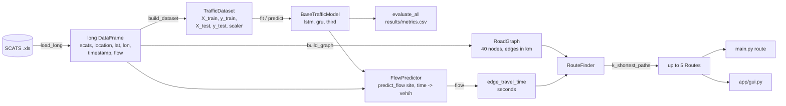

# Interfaces (the contracts between members)

These are what let four people code in parallel. **If you change one, open a PR and tag everyone who uses it.**

## Data flow



## 1. Long DataFrame - `src/data/loader.py` (Kevin -> everyone)

`load_long() -> pd.DataFrame` with exactly these columns:

| column | type | example |
|---|---|---|
| `scats` | int | `2000` |
| `location` | str | `"WARRIGAL_RD N of TOORAK_RD"` |
| `lat`, `lon` | float | `-37.8516`, `145.0943` (offset-corrected, never 0) |
| `timestamp` | Timestamp | `2006-10-15 08:00` (interval start) |
| `flow` | float | vehicles in that 15 min |

## 2. TrafficDataset - `src/data/preprocess.py` (Kevin -> Hassan, Ali Murtaza, Sakib)

| field | shape | note |
|---|---|---|
| `X_train`, `X_test` | `(n, lags)` | scaled, 2-D. DL models reshape to `(n, lags, 1)` themselves |
| `y_train`, `y_test` | `(n,)` | scaled |
| `scaler` | sklearn scaler | fitted on **train only** |
| `meta_test` | DataFrame | `location`, `timestamp` per test sample (for per-site / per-hour analysis) |
| `inverse(y)` | method | scaled -> vehicles per 15 min |

Split is **chronological** (`config: data.train_end_date`), never shuffled.

## 3. BaseTrafficModel - `src/models/base.py` (Hassan, Ali Murtaza, Sakib -> Sakib, Kevin)

```python
model = get_model("gru")             # registry.py
model.fit(X_train, y_train)          # returns self, fills model.history
model.predict(X) -> np.ndarray (n,)  # scaled
model.save(path_without_extension)
GRUModel.load(path_without_extension)
```

Saved to `models/saved/<name>.*` + one shared `models/saved/scaler.joblib`.

## 4. RoadGraph - `src/graph/graph.py` (Kevin)

```python
graph.nodes[2000] -> Node(scats, lat, lon, name, locations)
graph.neighbours(2000) -> [Edge(src, dst, distance_km, road), ...]
graph.haversine_km(a, b)
```

Edges are directed; two-way roads have both directions.

## 5. FlowPredictor - `src/prediction/predictor.py` (Kevin)

```python
predictor.predict_flow(scats: int, when: datetime) -> float   # vehicles per HOUR
```

`ConstantPredictor(200)` exists already so routing can be built and tested before any model is trained.

## 6. Search - `src/search/` (Kevin, reusing 2A unchanged)

```python
problem = TravelTimeProblem(graph, origin, [destination], cost_fn)   # 2A problem contract
goal, nodes_created, path = SEARCH_METHODS["AS"](problem)            # 2A search(), unchanged
k_shortest_paths(graph, origin, goal, cost_fn, k=5, method="AS") -> list[SearchResult]
```

`cost_fn(edge) -> seconds`. `TravelTimeProblem` exposes `origin`, `destinations`, `graph`,
`neighbors(n)`, `h(n)`, `is_goal(n)`, `path_cost(path)` exactly like 2A's `problem.py`.
`SearchResult(path, cost, nodes_created)`.

## 7. RouteFinder - `src/routing/route_finder.py` (Kevin -> Ali's GUI / CLI)

```python
RouteFinder(graph, predictor, cfg).find_routes(origin, dest, when, k=5, method="AS") -> list[Route]
route.travel_time_min, route.distance_km, route.roads, route.path, route.segments
```

## Open decisions (agree as a team, ask the tutor)

- [ ] Model 3: ______ (needs tutor approval)
- [ ] Edge flow uses origin site or destination site? Spec says B (destination), conversion PDF says starting site. -> `config: prediction.edge_flow_site`
- [ ] Aggregate approaches of one site with mean or sum? -> `config: prediction.site_flow_aggregation`
- [ ] How to handle query times outside Oct 2006 (map to same weekday + time?)
- [ ] Research initiative: ______
